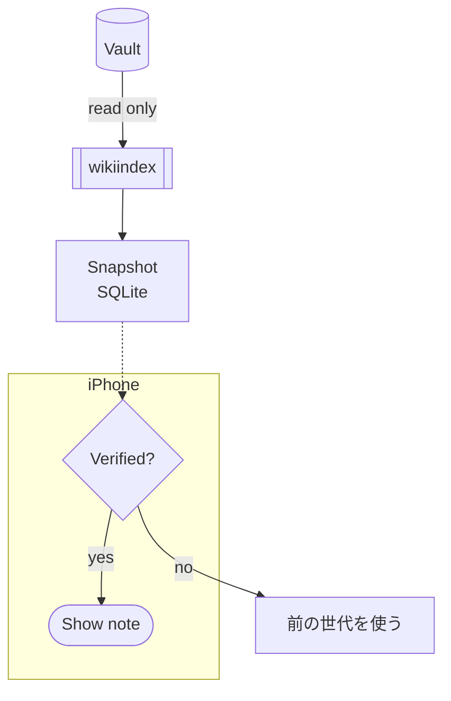

# Code

Inline `[[not a link]]` and `#nottag`.

```swift
let x = "[[also not a link]]" // #notatag
```

%% hidden comment with [[Hidden Link]] %%

Real link after code: [[Home]]

A Mermaid flowchart is drawn natively:


